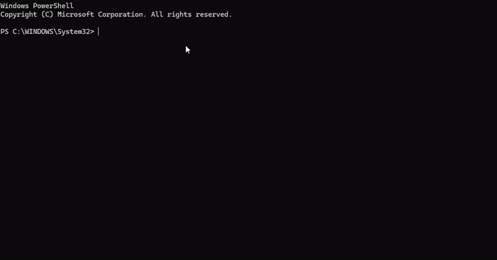
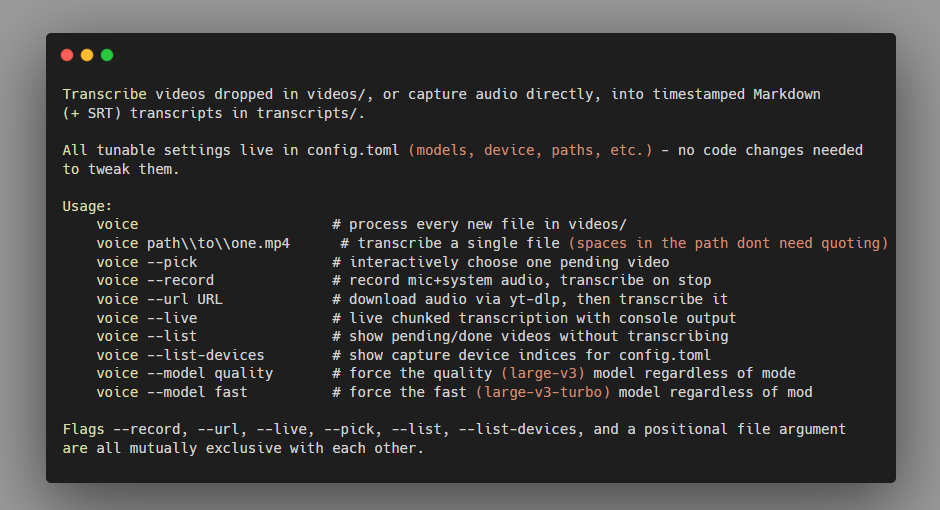

# voice-transcriber

Transcribes video and audio into timestamped Markdown, on your machine. Drop a file in, record your mic and system audio, paste a URL, or run it live while you talk. Nothing leaves your computer.

`config.toml` is the place to change behavior. `CLAUDE.md` is the map if you (or an agent) are editing the code.

[](https://github.com/icylito/voice-transcriber/actions/workflows/ci.yml)
[](LICENSE)
[](#quickstart)
[](#quickstart)



A real terminal recording, `voice --help` then a live transcription run. Source audio:
[demo_voiceover.wav](demo_voiceover.wav). Full video with sound: [Demo.mp4](Demo.mp4).

The transcript it produced:

```markdown
# demo

**[00:00 - 00:02]** Hey, this is a short clip for the subtitle demo.
```

It runs on [WhisperX](https://github.com/m-bain/whisperX) by [m-bain](https://github.com/m-bain), which does the actual speech recognition (`faster-whisper`) and word-level alignment (wav2vec2). WhisperX installs as a standard pip dependency through requirements.txt, so no manual setup is needed. This tool wraps that engine with what WhisperX doesn't handle on its own: capturing a mic and system audio at once, pulling audio from a URL, running live, and cleaning up the output.



There's no graphical interface yet, so these are terminal captures instead of app screenshots. A GUI is a planned direction, not built. See `future_plan.md`.

## Quickstart

Windows, Python 3.11 or newer, and `ffmpeg` on your PATH (`winget install Gyan.FFmpeg`, then open a fresh terminal). An NVIDIA GPU with CUDA is what makes this fast. See Benchmarks for the difference on the machine this was measured on. Ollama is optional, only for punctuation cleanup and auto titles.

```bash
git clone https://github.com/icylito/voice-transcriber.git
cd voice-transcriber

python -m venv .venv
.venv\Scripts\pip install torch --index-url https://download.pytorch.org/whl/cu128
.venv\Scripts\pip install -r requirements.txt

ollama pull qwen3:4b-instruct-2507-q4_K_M
```

Install torch before whisperx, in that order. Installing whisperx first pulls the default CPU-only torch wheel on Windows, and you lose GPU acceleration with nothing telling you it happened.

Check VRAM with `nvidia-smi` before the first real run. `large-v3` wants about 5.5GB at `float16`. On a smaller card, pick a smaller Whisper model or set `model.compute_type` to `int8` or `int8_float16` in `config.toml`.

Drop a file into `videos/` and run:

```bash
voice
```

`voice` is `voice.bat`. It puts `ffmpeg` on PATH and runs `transcribe.py`. Add the repo folder to your PATH and `voice` works from anywhere. From inside the repo, `.\voice` works either way. A transcript lands in `transcripts/` as a timestamped `.md`. `.srt` is off until you set `output.write_srt = true`.

## Commands

```bash
voice                          # process every new file in videos/
voice path\to\one.mp4          # transcribe a single file
voice --pick                   # interactively choose one pending video
voice --record                 # record mic+system audio, transcribe on stop
voice --url <URL>              # download audio via yt-dlp, then transcribe it
voice --live                   # live chunked transcription, streamed to console
voice --list                   # show pending/done videos, don't transcribe
voice --list-devices           # show mic/loopback device indices for config.toml
voice --model quality          # force the quality model regardless of mode
voice --model fast             # force the fast model regardless of mode
```

`--record` and `--live` keep the mic and whatever is playing through the speakers as two streams, so each block is labeled `(user)` or `(system)`. A file or a URL is one source, so those transcripts stay unlabeled.

Two extras go through a local model in Ollama: punctuation cleanup, and a title taken from what was said. Both are on by default. If Ollama is down, the transcript still gets written. Those two steps are skipped.

## Configuration

Tunables live in `config.toml`.

```toml
[model.quality]
name = "large-v3"         # batch/--pick/single-file/--record/--url

[model.fast]
name = "large-v3-turbo"   # --live only

[llm]
model = "qwen3:4b-instruct-2507-q4_K_M"
enabled = true      # punctuation and capitalization cleanup
auto_title = true   # LLM-generated transcript titles
auto_start = true   # offer to launch Ollama if it's not running
```

`ollama pull` whatever you set as `llm.model`. The plain `qwen3:4b` tag spends 30 to 40 seconds thinking on each call for this job, which is why the install step pulls the `-instruct` tag. Turn `enabled` and `auto_title` off and the tool never talks to Ollama.

## Benchmarks

Two short public-domain speeches from the [Internet Archive](https://archive.org/details/Greatest_Speeches_of_the_20th_Century), run through `voice --url <clip>` end to end: download, model load, transcribe, align, punctuation cleanup. Wall clock for the command you would type.

| Clip | Length | Model | Wall clock | Real-time factor |
|---|---|---|---|---|
| Address on Vietnam War Protests | 2:16 | large-v3 (quality) | 44.0s | 3.1x faster than real time |
| Address on Vietnam War Protests | 2:16 | large-v3-turbo (fast) | 26.8s | 5.1x faster than real time |
| Abdication Address | 6:42 | large-v3 (quality) | 2m 48s | 2.4x faster than real time |
| Abdication Address | 6:42 | large-v3-turbo (fast) | 35.5s | 11.3x faster than real time |

These numbers are for the hardware below. GPU, VRAM, CPU, and disk all move them. Forced alignment scales with how many speech segments the audio has, so a longer clip with fewer, longer segments can align faster than a short one full of quick back and forth.

### Hardware these ran on

| | |
|---|---|
| GPU | NVIDIA GeForce RTX 3080, 10GB VRAM |
| CPU | Intel Core i9-12900K |
| RAM | 32GB DDR5 6000MHz CL30 |
| Storage | NVMe SSD |
| OS | Windows 11 Pro |

## Contributing

CI (`.github/workflows/ci.yml`) runs syntax checks, `ruff`, config validation, and `pytest` on every push. It covers pure logic in `tests/`. GitHub's runners have no GPU and no mic, so a green check does not exercise capture or Whisper. If you change `transcribe.py`, `capture.py`, `live.py`, or `fetch.py`, run that mode and read the transcript before opening a PR. `CLAUDE.md` has the architecture notes for capture and the LLM steps.

Open an issue for bugs or feature ideas. For Windows audio problems, include the device names from `voice --list-devices`.

## License

BSD 2-Clause, see [LICENSE](LICENSE).

This project runs on [WhisperX](https://github.com/m-bain/whisperX), also BSD 2-Clause, copyright Max Bain. Full credit to that project for the speech recognition and alignment engine underneath this tool.

This project was fully written by Claude [claude.ai](https://claude.ai/)
